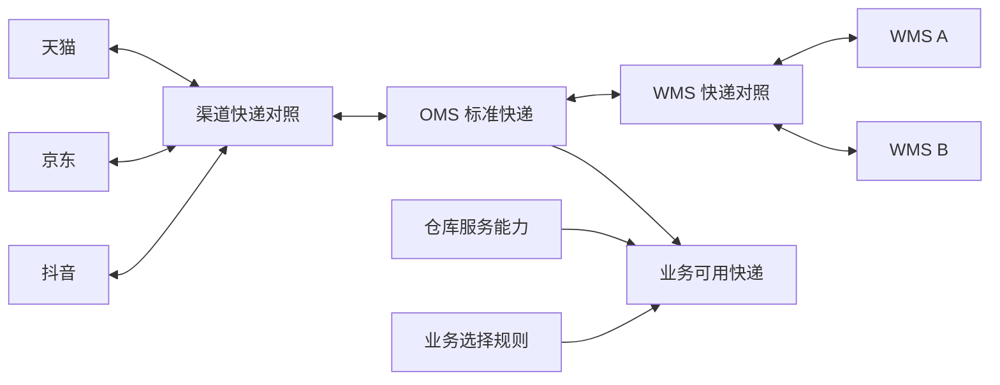

# 公共快递配置与渠道、WMS 编码对照 PRD

| 项目 | 内容 |
| --- | --- |
| 文档版本 | V1.1 |
| 文档状态 | 本期天猫及仓库范围已实现，本地验收通过；真实外部接口联调单独验收 |
| 编写日期 | 2026-10-26 |
| 所属产品 | OMS SaaS |
| 上游范围 | 当前接入天猫；京东、抖音保留模型及入口，后期扩展 |
| 下游范围 | 通过奇门或其他协议接入的 WMS |
| 设计边界 | 按新方案统一设计，不考虑历史数据迁移、旧配置或接口兼容、存量单据处理 |
| 面单边界 | 本期按 WMS 负责电子面单取号和打印，OMS 负责快递选择、编码转换及物流信息回传设计 |

## 1. 背景与目标

OMS 对接多个电商渠道和多个 WMS。同一家快递在不同平台、不同接口用途、不同 WMS 中，可能使用不同的编码、名称或标识。

销售发货、换货发货、采购退仓、售后退回、供应商拒收收回等业务都需要识别快递、查询可用选项和转换外部编码。如果各模块分别维护，容易出现编码含义混淆、对照重复、仓库编码直接用于平台回传、收货快递受到发货规则限制等问题。

本项目建设公司内共用的快递配置能力，实现：

1. 同一家快递在 OMS 内具有稳定、明确的标准身份。
2. 渠道和 WMS 分别与 OMS 标准快递建立对照。
3. 各业务通过统一接口查询、识别和转换快递编码。
4. 编码对照、仓库服务能力、业务选择规则分别维护。
5. 对照缺失或冲突能够定位到具体系统、配置和受影响业务。

本文中的页面、字段及流程为目标需求，不表示相关能力已完成开发或已开通平台接口权限。

## 2. 术语与设计原则

| 术语 | 定义 |
| --- | --- |
| 渠道 | 天猫、京东、抖音等交易平台及其店铺接入 |
| 标准快递 | OMS 内用于统一识别承运商的资料，如顺丰速运、中通快递 |
| 外部快递目录 | 渠道或 WMS 提供的快递编码、名称和状态列表 |
| 快递编码对照 | 外部快递标识与 OMS 标准快递之间的对应关系 |
| WMS 连接实例 | 某个实际接入的仓储系统连接，用于区分不同供应商或不同部署实例 |
| 仓库服务能力 | 指定货主、实仓是否支持某快递及其发货、收货等用途 |
| 业务选择规则 | 店铺允许快递、优先顺序、目的地区域、渠道指定物流等选择约束 |
| 接口用途 | 发货回传、售后寄回物流、WMS 出库下发、WMS 出库回传、WMS 退回入库等用途 |
| 原始物流事实 | 外部系统回传或凭证登记的原始快递名称、编码、运单号及来源 |

设计原则：

- 京东作为交易渠道，与京东快递、京东快运等承运商分别建模。
- 标准快递标识、外部编码、运单号、包裹号分别存储，不能相互替代。
- 编码对照回答“外部编码对应哪家快递”，业务选择规则回答“本次业务选择哪家快递”。
- 渠道支持某快递、商家签约某快递、仓库能使用某快递，分别表达。
- 发货编码、退货物流编码和电子面单编码按接口用途识别；只有确认使用同一代码集时才允许共用。
- 名称相似、运单号格式或前缀可用于辅助提示，不能单独作为正式映射依据。
- 配置按公司隔离，跨模块复用不代表跨公司共享生效对照。

## 3. 范围与分期

### 3.1 一期：公共配置与完整转换链路

| 编号 | 需求 | 优先级 |
| --- | --- | --- |
| R01 | 标准快递资料管理 | P0 |
| R02 | 外部快递目录维护，支持手工维护和文件导入 | P0 |
| R03 | 天猫、京东、抖音等渠道快递对照 | P0 |
| R04 | WMS 快递对照 | P0 |
| R05 | 仓库发货、收货服务能力配置 | P0 |
| R06 | 公共快递查询、编码识别和转换能力 | P0 |
| R07 | 各业务表单接入共用选择器 | P0 |
| R08 | 缺失、冲突和失效映射待办及重试 | P0 |
| R09 | 配置权限、并发编辑校验和操作记录 | P0 |

### 3.2 二期：目录同步与配置效率

- 对具备接口能力和权限的渠道、WMS 增加目录同步。
- 展示目录同步状态、新增编码、名称变化、外部停用情况及同步失败原因。
- 根据目录提供候选匹配建议，由维护人员确认后生效。
- 增加批量对照维护、变更影响预览和编码转换验证工具。

### 3.3 本期范围外

- 历史数据迁移、旧配置和旧接口兼容、存量单据处理。
- OMS 电子面单取号、打印组件、面单账号、网点、余额和打印模板管理。
- 运费结算、承运商账单、采购物流合同。
- 重建销售业务的自动选快递策略。
- 以公共配置建设替代各渠道真实发货、售后及 WMS 接口的适配与联调。

## 4. 角色与公共入口

公共入口建议为：`公共配置 → 快递管理`。

| 角色 | 主要职责 |
| --- | --- |
| 基础资料维护人员 | 维护标准快递、别名和启停状态 |
| 渠道对接人员 | 维护平台目录、渠道编码对照和适用范围 |
| 仓储对接人员 | 维护 WMS 目录、编码对照、货主实仓服务能力 |
| 业务操作人员 | 在业务表单选择快递，查看异常和提交核对信息 |
| 系统管理员 | 分配权限、查看跨模块配置状态和操作记录 |

公共入口包含五个页面：

1. 标准快递资料。
2. 渠道快递对照，包含对应外部目录。
3. WMS 快递对照，包含对应外部目录。
4. 仓库服务能力。
5. 映射待办。

业务人员查看下拉选项和单据解析结果，不要求同时拥有配置维护权限。

## 5. 总体模型

标准快递、外部目录、编码对照和仓库服务能力分别管理。业务选择规则引用标准快递，不在规则中填写外部编码。

## 6. 功能需求

### 6.1 标准快递资料（R01）

核心字段：

| 字段 | 说明 |
| --- | --- |
| 标准快递标识 | 系统生成的稳定身份，供业务引用 |
| OMS 标准编码 | 公司内唯一的业务编码，创建后固定 |
| 标准名称 | 业务表单和列表优先展示的名称 |
| 别名 | 辅助搜索和推荐匹配，不直接形成编码对照 |
| 分类 | 快递、快运或其他明确分类 |
| 状态 | 启用、停用 |
| 备注 | 说明适用边界和核对依据 |

规则：

- 公司内标准编码唯一，同名或相似名称给出重复提醒。
- 不同承运商、快递与快运不能仅因名称相似而合并。
- 同一承运商下存在不同运输产品时，优先用产品字段表达；确属不同对外承运主体时分别建档。
- 业务表单选择标准快递，不允许任意输入一个字符串即创建正式标准资料。
- 停用后不再作为新业务的可选项，查询结果仍能展示停用原因。

### 6.2 外部快递目录（R02）

目录至少包含：系统类型、平台或 WMS 提供方、连接或目录作用范围、接口用途、外部编码、外部名称、状态、来源、核对时间。

一期支持手工维护和文件导入，导入前预览新增、更新、重复及错误记录。外部编码按原值保存，保留大小写、前导零和特殊字符，不按统一规则改写。

目录记录与正式对照分别管理：目录存在不代表已经完成 OMS 归一，也不代表商家已签约或仓库已启用该快递。

外部目录不可用时，可以依据平台或仓库正式提供的资料维护，并记录来源和核对依据。

### 6.3 渠道快递对照（R03）

对照字段：公司、渠道类型、接口用途、适用连接或店铺、外部目录记录、OMS 标准快递、转换方向、产品条件、状态、核对依据。

渠道关联按具体业务用途自动确定方向，不再让操作人员选择 IN、OUT 或双向。

| 业务用途 | 处理流向 | 内部用途标识 |
| --- | --- | --- |
| 销售发货回传 | OMS 标准快递 → 平台物流标识 | CHANNEL_SHIPPING |
| 换货发出物流回传 | OMS 标准快递 → 平台物流标识 | CHANNEL_EXCHANGE_LOGISTICS |
| 识别买家寄回物流 | 平台原始物流标识 → OMS 标准快递 | CHANNEL_RETURN_IDENTIFY |
| 向平台回填寄回物流 | OMS 标准快递 → 平台物流标识 | CHANNEL_RETURN_BACKFILL |

寄回识别与平台回填使用独立清单和关联，不借用另一业务动作的编码。服务端在单条保存、批量建立和实际转换时校验业务动作对应的方向。

规则：

- 平台通用代码集按平台和接口用途共用，确有差异时配置连接或店铺级对照。
- 同用途下，店铺专属对照优先于连接级对照，连接级对照优先于平台通用对照。
- 精确范围已命中失效或冲突配置时，明确报错，不静默回落到更宽范围。
- 同一有效范围内，一个外部编码只能解析到一个 OMS 标准快递。
- 多个外部编码可识别为同一家 OMS 快递；向外转换存在多个候选时，必须通过明确的产品条件或唯一默认项选定。
- 渠道页面将“默认输出”展示为“平台提交首选项”，仅在同用途、同范围和同产品存在多个提交候选时显示；单一候选自动处理，寄回识别用途不设置首选项。
- 配置编辑器以一次有界批量查询检查候选，最多100项；按公司、用途、精确范围和标准快递过滤，不在订单或库存处理链路增加查询。
- 不同接口用途之间不自动借用编码。
- “其他”仅在目标接口明确支持、业务符合其要求时配置使用，不作为通用兜底。

### 6.4 WMS 快递对照（R04）

对照字段：公司、WMS 连接实例、货主和实仓适用范围、接口用途、外部编码、外部名称、OMS 标准快递、转换方向、产品条件、状态、核对依据。

规则：

- WMS 连接实例为必填，不能把一家仓库的自定义编码直接用于另一家仓库。
- WMS 对照按接口用途自动确定方向：出库下发、退回入库下发使用“下发编码转换”；实际出库回传、实际入库回传使用“回传快递识别”。新增、编辑和批量建立时均不再手工选择转换方向，服务端保存及批量确认按同一规则确定方向。
- 回传识别不配置“默认输出”，服务端固定保存为非默认输出；下发编码转换仍需按产品或唯一默认项确定输出编码。切换接口用途后清空原目录选择并重新核对。
- 货主、实仓按 WMS 实际代码集配置；若选择某实仓范围，必须同时明确其货主。
- 同用途下，货主加实仓的精确配置优先于货主级配置，货主级配置优先于连接通用配置。
- 同一范围下的输入识别及输出转换，分别满足唯一性要求。
- 页面清楚区分 OMS 标准编码和 WMS 编码，不使用一个含义不明的“快递编码”字段表达两者。
- 奇门或其他协议的字段映射由对应适配器完成，不要求外部系统使用 OMS 编码。

### 6.5 仓库服务能力（R05）

能力配置包含：公司、WMS 连接、货主、实仓、标准快递、支持用途、适用产品、目的地区域限制、状态及备注。

规则：

- 支持用途至少区分发货与收货。
- 发货可配置允许和排除的目的地区域；同一地区不能同时允许和排除。
- 收货能力不套用该仓对外发货的目的地省份限制。
- 标准快递启用不要求必须配置某个仓库的发货能力。
- 具备编码对照不自动代表该仓能够使用该快递，能力配置生效也不替代编码对照校验。
- 支持某家快递，不自动代表商家已经拥有该快递的电子面单签约或取号能力。

### 6.6 公共查询、识别和转换（R06）

以下为能力定义，不约定最终接口路径和部署服务。

| 能力 | 输入上下文 | 返回内容 |
| --- | --- | --- |
| 标准快递搜索 | 当前公司、名称、编码、别名、状态 | 标准身份、标准编码、名称、分类、状态 |
| 业务可用快递查询 | 业务用途、渠道或店铺、WMS 连接、货主、实仓，发货时包含必要的目的地区域 | 可选快递及不可用原因，展示可见的目标系统编码 |
| 外部快递识别 | 来源系统、连接、用途、适用范围、原始编码，必要时包含产品 | 唯一标准快递、命中范围或明确异常 |
| 外部编码转换 | 标准快递、目标系统、连接、用途、适用范围和产品 | 唯一目标编码、名称、命中配置或明确异常 |
| 转换预览 | 来源、目标及业务上下文 | 来源编码 → OMS 标准快递 → 目标编码的解释结果 |

成功、缺失、冲突、停用、业务能力不支持、外部目录不可用等结果必须可区分。缺失或冲突时不能返回第一条候选当作成功结果。

公司身份从登录或可信内部调用上下文取得，不能通过普通查询参数切换公司。

### 6.7 共用选择器（R07）

适用表单包含销售发货选快递、换出发货、采购退仓、售后退回物流、拒收收回入库和包裹物流核对。

交互要求：

- 支持按标准名称、OMS 编码及别名搜索。
- 主展示为标准名称，辅助展示 OMS 编码；必要时展示当前目标 WMS 或渠道的对照编码。
- 下拉值使用明确的标准身份，由提交接口按业务上下文转换外部编码。
- 无可用选项、加载失败、未配置映射和仓库能力不支持分别提示，不使用同一条“暂无数据”覆盖。
- 无配置维护权限的业务人员仍能查看选项和异常原因。
- 配置维护人员可以从异常跳转到带上下文的配置页面。
- 切换公司上下文、店铺、连接或仓库后重新查询，较早请求不能覆盖新上下文结果。
- 对无法识别的实际寄回物流，允许保存原始名称、编码、运单和凭证，标记“待映射”；不得将其直接视为已确认标准快递。
- 需向 WMS 下发的业务，在下发前必须完成目标编码及相关能力校验。

### 6.8 映射待办（R08）

待办类型至少包含：外部编码未识别、目标映射缺失、命中多条配置、配置或目录编码失效、仓库能力不支持、渠道指定快递与实际快递不一致。

每条待办展示：业务类型和单号、来源与目标系统、连接或店铺、货主实仓、原始编码和名称、标准快递、接口用途、阻断动作、异常原因、处理状态。

相同业务事实、相同用途和相同异常来源重复到达时，更新同一待办，不重复新增。

处理流程：打开待办 → 查看原始事实和转换预览 → 维护配置或核对差异 → 重新校验 → 重试对应未完成动作。重试不得重复执行已成功的出入库。

配置修复不代表业务自动完成。只有目标动作执行成功并取得对应结果，业务才进入其完成状态。

### 6.9 权限和操作记录（R09）

- 区分资料查询、标准资料维护、渠道对照维护、WMS 对照维护、仓库能力维护、待办处理和操作记录查询权限。
- 保存配置时校验编辑版本，避免并发操作覆盖其他人的修改。
- 新增、修改、启停、导入、对照确认、异常处理及重试记录操作者、时间、对象和核对依据。
- 权限校验在服务端执行，页面隐藏按钮不能替代服务端控制。

## 7. 核心业务流程

### 7.1 销售及换出发货

1. 获取订单渠道、店铺、仓库、货主、目的地区域及平台指定物流要求。
2. 业务规则选择 OMS 标准快递；平台有明确指定要求时，先满足该要求。
3. 校验标准快递状态、仓库发货能力和目标 WMS 编码。
4. 按对应协议向 WMS 下发所需编码和产品信息。
5. WMS 处理发运并回传实际快递、包裹、运单和商品数量。
6. 按原 WMS 连接及业务上下文识别实际快递。
7. 根据实际快递转换订单所属渠道的发货回传编码，执行相应渠道通知。

正常订单没有指定快递时，由业务规则选择，不要求每张平台订单都有一个待转换的快递编码。

实际快递与计划不同，分别保留计划与实际事实，并重新校验平台指定要求。违反指定要求时生成待办，不把实际快递改写成计划快递后回传。

### 7.2 WMS 已出库，渠道映射缺失

1. 保存 WMS 原始物流和实际出库事实。
2. 单据身份、商品、批次和实际数量等校验均通过时，库存按正常幂等规则入账。
3. 将平台通知置为待配置或待处理，展示缺少的渠道、用途及标准快递。
4. 补齐映射后，仅重试平台通知。

渠道映射缺失不能回滚真实出库、修改实出数量或产生第二次扣库。单据身份或数量等校验失败仍进入相应业务异常流程。

### 7.3 采购退仓

1. 选择原采购及本次退仓商品，取得实际执行的货主、实仓和 WMS 连接。
2. 从具备退仓发货能力的标准快递中选择。
3. 审核和下发前校验目标 WMS 对照及相应能力。
4. WMS 按实际出库回传物流，OMS 识别实际快递并关联原执行及包裹。
5. 包裹资料补录和快递对照修复只完善物流，不额外扣库。

采购退仓以其供应商和仓储链路为上下文，不要求附带天猫、京东、抖音的销售发货映射。

### 7.4 售后退回及供应商拒收收回

1. 保存渠道提供、买家填写或供应商凭证确认的实际寄回物流。
2. 根据实际来源的系统、接口用途和编码识别标准快递。
3. 无法识别时保存原始事实并进入待映射，不按名称猜测。
4. 创建并下发退回入库业务时，校验收货仓对应的 WMS 编码和收货能力。
5. 仓库实际实收后，依正常收货规则按实际数量和质量入账。

登记快递、签收物流、修复映射及审核收回单均不直接增加库存。已经到达仓库的收货事实应留存；能否入账由原业务单据身份、商品和实收校验决定。

### 7.5 多包裹和多运单

- 实际快递及其转换结果以具体包裹或物流事实为单位记录。
- 一个执行单允许多个包裹、多个运单，实际快递也可能不同。
- 同一运单下的多个包裹分别保留，不能以运单号作为包裹唯一标识。
- 不同包裹分别转换所属渠道需要的编码，并按渠道支持的整单、拆单或包裹接口提交。
- 仅有头部运单时，保留头部物流，不据此生成包裹商品归属。

## 8. 异常处理矩阵

| 异常 | 目标行为 | 恢复动作 |
| --- | --- | --- |
| 标准快递停用 | 新业务不可选，提示停用 | 选择其他有效快递或维护资料 |
| 下发前缺少 WMS 对照 | 阻止相关下发，保留业务申请 | 配置后重新校验并重试下发 |
| WMS 回传编码未识别 | 保存原始物流，生成待办；身份和数量校验通过的实物账按业务规则处理 | 确认来源编码后修复识别及后续通知 |
| 已实际出库但缺渠道编码 | 保留实出和库存结果，平台回传待处理 | 补齐映射后只重试平台回传 |
| 多条候选无法唯一识别或转换 | 明确报冲突，不任意选择 | 调整范围、产品条件或默认项 |
| 收货快递不在销售配送范围 | 不使用销售发货范围判定收货是否可用 | 根据收货能力和入库编码校验 |
| 平台指定与实际快递不一致 | 保留两种事实，生成核对待办 | 按平台实际规则处理差异及通知 |
| 目录查询或同步失败 | 展示来源、失败原因及可用状态；不能清空已确认对照 | 重试查询或依据正式资料维护 |
| 重复回传或重复重试 | 复用业务幂等身份，不重复出入库或成功通知 | 展示已完成结果 |

## 9. 数据记录与性能要求

### 9.1 逻辑数据对象

| 对象 | 职责 |
| --- | --- |
| 标准快递 | 统一身份、名称、别名及状态 |
| 外部目录 | 各系统、范围、用途的原始编码及来源 |
| 编码对照 | 识别方向、转换方向、范围、产品和唯一目标 |
| 仓库服务能力 | 货主实仓对应的发货、收货及地区能力 |
| 业务转换记录 | 本次业务所用来源编码、标准身份、目标编码和命中配置 |
| 映射待办 | 异常原因、关联业务及处理进度 |
| 操作记录 | 配置和处理动作的操作者、时间及依据 |

具体建表、字段类型、服务归属及接口路径在技术设计中确定，按统一目标模型建设。

### 9.2 新业务执行记录

每次对外执行记录实际使用的标准快递、目标编码、配置版本、接口用途和请求身份。已提交执行的请求，网络重试使用同一执行身份及确定的请求内容。

尚未成功、因缺少映射而等待的动作，修复后可以创建明确的重试执行。不能借修复快递对照改变原商品、数量、批次或实际出入库结果。

### 9.3 性能和一致性

- 下拉支持搜索和有界分页，避免一次加载大量无关连接或店铺目录。
- 业务列表批量读取快递名称、转换结果和异常，不逐行跨服务请求。
- 目录同步在后台执行，不阻塞表单打开。
- 若使用缓存，键包含公司和相关系统范围；配置变更后应使对应缓存失效或校验新版本。
- 批量导入先校验再确认，逐行返回错误；有效对照不能因同步暂时失败被整批删除。

## 10. 一期验收标准

| 编号 | 验收场景 | 通过标准 |
| --- | --- | --- |
| A01 | 创建标准快递 | 同公司编码唯一；名称和别名可搜索；业务不能任意创建正式编码 |
| A02 | 多公司隔离 | 查询、维护、导入和识别均不能访问其他公司配置 |
| A03 | 三渠道识别 | 天猫、京东、抖音各自的有效测试目录编码能归一到正确标准快递 |
| A04 | 同平台不同用途 | 发货和售后代码集存在差异时按用途命中，不混用 |
| A05 | 多 WMS 同码不同义 | 不同 WMS 连接中相同外部编码可以正确区分 |
| A06 | 货主实仓范围 | 精确范围优先，冲突或失效不静默回落 |
| A07 | 多对一及一对多 | 多个输入码可归一；输出存在多个候选时按条件唯一选择或报错 |
| A08 | 仓库发货能力 | 目的地区域、产品及启用状态影响可用选项，原因可查看 |
| A09 | 仓库收货能力 | 已配置收货能力的快递不因销售发货地区限制被排除 |
| A10 | 采购退仓下发 | 选择标准快递后提交正确 WMS 编码，不要求销售渠道映射 |
| A11 | 实际出库转换 | 使用包裹实际快递识别并转换，计划与实际不同可追踪 |
| A12 | 出库后缺渠道映射 | 保留实物入账，生成回传待办；修复后不重复扣库 |
| A13 | 下发前缺 WMS 映射 | 阻止下发并能跳转精确配置，修复后继续正常业务 |
| A14 | 寄回物流未识别 | 能保存原始事实和待办，不猜测正式映射、不提前增加库存 |
| A15 | 多包裹共运单 | 包裹独立保留，分别识别，商品和数量不重复累计 |
| A16 | 平台指定快递差异 | 计划和实际分别展示，触发核对，禁止伪装成计划快递回传 |
| A17 | 表单加载与权限 | 业务角色可使用下拉；维护按钮和写接口按权限控制；过期请求不覆盖新上下文 |
| A18 | 重试与并发编辑 | 已成功动作不重复执行；旧编辑版本不能覆盖新配置 |
| A19 | 导入和查询失败 | 错误明确到记录或来源，不清空有效配置 |
| A20 | 操作留痕 | 能查到配置、核对、启停及重试的操作者、时间和依据 |

测试用外部编码应明确标记为测试资料。真实接入验收使用实际平台授权和 WMS 已核对的编码，不把示例编码当成正式编码。

## 11. 交付内容及实施顺序

一期交付：五个配置和待办页面、共用选择器、统一查询和转换能力、各业务接入、权限与操作记录，以及对应验收证据。

建议实施顺序：

1. 确定标准身份、接口用途、范围和唯一性规则。
2. 建设标准资料、目录、上下游对照和仓库能力。
3. 提供统一查询、识别、转换及异常结果。
4. 接入销售及换出发货、采购退仓、售后退回、拒收收回和包裹核对。
5. 完成缺失待办、修复重试和一期验收。
6. 二期接入官方目录同步及维护效率工具。

公共配置验收与三平台真实业务接口验收分别记录。配置功能通过，不能直接认定平台真实发货回传、售后或电子面单能力已经开通。

## 12. 开发前需核实的接入条件

| 条件 | 本文默认设计 | 需核实内容 |
| --- | --- | --- |
| 电子面单 | WMS 取号、打印 | 试点业务是否存在由 OMS 取号的例外；存在时单独扩展需求 |
| 渠道目录 | 按平台和接口用途维护 | 天猫、京东、抖音实际接入接口版本、目录来源及账号权限 |
| WMS 目录 | 支持查询则同步，否则导入维护 | 各连接是否实现目录查询，编码是否按货主、实仓或产品区分 |
| 标准分类 | 快递、快运和必要的产品分别表达 | 首批承运商是否存在同品牌不同主体或产品编码差异 |
| 试点范围 | 覆盖正向发货及反向收回 | 首批店铺、WMS 连接、货主实仓及真实联调环境 |

这些条件用于确定适配和验收范围，不改变“新方案统一设计、不考虑历史问题”的边界。

## 13. 公开参考资料

以下资料用于核对外部接口和借鉴公开产品行为。本文的公共模型、页面组织及分期为本项目方案，并非对其他产品内部架构的断言。查阅日期：2026-10-26。

| 来源 | 可借鉴内容 | 链接 |
| --- | --- | --- |
| 网上管家婆 2026 年 9 月更新说明 | 标准物流编码选择，减少任意自填编码造成的同步失败 | [更新说明](https://helpnew.wsgjp.com/7469/c947b) |
| 网上管家婆 2025 年 4 月更新说明 | 物流映射异常提示，并从业务跳转映射配置 | [更新说明](https://helpnew.wsgjp.com/7469/d069) |
| 聚水潭开放平台出库发货接口 | 发货前配置物流公司及编码，并传递仓库和物流信息 | [出库发货](https://openweb.jushuitan.com/dev-doc?docId=35&docType=8) |
| 旺店通开放平台订单查询接口 | 物流类型、系统物流 ID、自定义物流编码和名称分别表达 | [官方接口](https://open.wangdian.cn/qyb/open/apidoc/doc?path=sales_trade_query.php) |
| 淘宝开放平台物流资源公告 | 物流资源会变化，旧目录接口可能不能覆盖新增编码 | [京东物流上线公告](https://open.fliggy.com/support/announcementDetail.htm?id=25747&source=search) |
| 抖店开放平台发货接口 | 发货 company_code 从平台快递公司列表获取 | [官方接口](https://op.jinritemai.com/docs/api-docs/16/79) |
| 京东宙斯开放平台面单能力 | 商家已签约承运商属于需独立识别的能力范围 | [官方能力说明](https://jos.jd.com/powercenterdetail?abilityId=30) |
| 奇门配送公司信息查询 | WMS 配送公司目录查询及外部编码、品牌信息 | [expressinfo.query](https://developer.alibaba.com/docs/api.htm?apiId=27530) |

外部目录接口、用途及调用权限以实际接入时核实的官方版本和账号能力为准。

## 14. 本次交付与验收记录（2026-10-27）

本期以天猫为渠道实施范围。京东、抖音在配置模型中保留平台维度，页面标记“后续扩展”且不能选择，不代表已接通对应渠道接口。

- 公共入口：公共配置 → 快递管理，包含标准资料、渠道对照、WMS 对照、仓库服务能力和映射待办五个页面。
- 业务侧使用标准身份选择快递。销售发货及换出、采购退仓、售后退回和供应商拒收收回按实际来源及目标用途转换编码。
- 原始回传物流与标准身份分别保存。一个运单下的不同包裹分别识别，未知编码不阻断通过原业务身份及数量校验的实际出库记账。
- 配置修复后重新校验，物流修复和平台通知仅继续未完成步骤。需要业务审批的草稿仍回原单确认，不由配置人员重试替代审批。
- 供应商未知寄回物流可以先保存原始名称、编码和运单为待核实草稿；审核前需凭证确认标准快递和仓库收货能力。登记物流、审核及修复对照均不直接增加库存。
- 目录同步、物流识别使用有界后台线程池，按公司领取有限任务，保留公司路由上下文。目录查询失败保留原目录及对照；查询成功先预览，由维护人员确认导入。
- 列表、搜索、文件导入和批量对照均限制单次规模。自动选快递批量读取映射与仓库能力，后台任务有公司及状态时间索引。数据库新增对象及字段均附中文用途备注。

本地验收结果：481 条后端测试、27 个测试套件通过；23 个相关 Vue 组件校验通过；9 项浏览器检查及业务查询、公共只读两类账号的服务端权限检查通过。

保留测试单 `CGTe0539389615b4eb0959e46ca6875f6c3`：采购实收10件、退仓预占5件、两个包裹共用运单实出5件。重复回传及修复原始快递识别后，总库存和可用库存仍为5件，分配和预占均为0。原有验收单据、库存、报告清单、队列策略和全局任务开关核对保持不变。

[详细验收报告](../../outputs/shared-carriers/验收报告.html)及同目录 JSON 保存测试场景、单据、实际结果、库存变化、权限检查和页面截图。接口耗时仅为本地抽样，不作为生产容量结论。

真实外部联调边界：现有销售发货通知网关仍为 `SIMULATION`；天猫真实发货通知、电子面单账号及仓库正式环境权限不计入本次本地验收。奇门目录查询适配已实现；本地模拟仓未实现该查询方法，已验收其后台失败状态及不清空配置的行为。

## 15. 前台名称统一（2026-10-27）

面向操作人员使用“快递清单”和“标准快递关联”，逻辑模型中的目录记录、关联规则及 API 字段保持各自职责。

| 场景 | 页面名称或操作 |
| --- | --- |
| WMS 提供的快递名称、编码集合 | 仓库快递清单 |
| 渠道提供的快递名称、编码集合 | 平台快递清单 |
| OMS 统一的承运商资料 | 标准快递资料 |
| 外部编码与 OMS 标准快递的关系 | 标准快递关联 |
| 手工添加清单条目 | 补录仓库快递 / 补录平台快递 |
| 建立单条、批量对应关系 | 关联标准快递 / 批量关联标准快递 |
| 文件导入及接口读取 | 导入快递清单 / 同步快递清单 |
| 查询清单的接口更新过程 | 清单更新记录 |

清单中存在一个编码、已经关联标准快递、实际业务可以使用该快递，是三个独立含义。清单导入或关联完成的页面提示不能直接表示仓库服务能力已通过。

## 16. 运输产品与配置来源的页面表达（2026-10-27）

- 当前渠道发货、换货及退款物流转换未传入运输产品条件，渠道关联的新增、编辑、批量关联和转换核验隐藏该输入，列表不展示“默认产品”。
- WMS 关联、仓库服务能力及 WMS 转换核验保留“运输产品编码”。填写仓库约定的运输服务编码；业务传入的编码优先匹配专用配置，未命中时使用留空的通用配置。“通用匹配”不表示自动选择某种运输产品。
- 单条配置、批量关联和清单导入统一使用“配置来源与确认说明”，必填并提供清单文件、版本或沟通确认记录的填写示例。页面在提交前提示缺失内容，保留原有后台必填要求及长度限制。
- 列表使用“状态与配置来源”，转换核验结果展示“配置来源与确认说明”，操作记录提供变更内容和配置来源追溯。
- 本次调整只影响前台表达和提交提示，沿用现有字段与匹配逻辑，不增加查询、数据库字段或库存操作。

## 17. 快递管理页面操作衔接（2026-10-27）

- 保留五个菜单，页面只展示一处标题，侧栏完整显示名称。查询与维护操作分区，清单同步、全局操作记录归入“更多”。
- 关联列表分别展示标准快递、外部快递、业务用途、适用范围、配置状态和指定场景检查；编码支持复制，长名称和范围受控展示。
- 清单展示未关联、已关联、关联已停用三种配置状态，可在服务端筛选并分页。单条清单可直接关联或查看关联，自动带入原编码、用途和范围。
- WMS 按连接、货主和实仓逐级筛选；渠道按天猫店铺筛选。筛选条件与分页写入当前页面路由，刷新保留；提供重置。
- 表单按适用对象、快递关系、来源确认分组。统一使用“业务用途”；处理说明显示在用途下方。指定店铺、货主和实仓的范围不得因漏填内容而静默保存为通用范围。
- WMS 与渠道共用有界批量候选查询。WMS 多候选显示“仓库下发首选项”，单候选自动处理；输入识别用途不配置首选。批量内同标准、同产品的首选开关互斥，其他已保存关联不会被界面静默修改。
- 仓库服务能力分发货与收货查询；配送范围摘要展示，可展开完整省份。收货不应用发货配送省份。
- 场景核验覆盖销售发货回传、售后退回入库、换货发货回传、寄回物流回填、仓库发货下发及仓库退回入库下发。关联行可直接检查本用途，支持从 OMS 标准身份开始检查。
- 核验分别展示来源识别、目标编码、仓库能力；标明范围、时间与命中层级。条件变化时清空旧结果，配置版本变化时清空行检查标记。检查不冻结执行请求，不改变单据、库存或外部业务状态。
- 待修复提供“去修复配置”“检查修复结果”，检查通过后提供“继续未完成步骤”；已完成不展示修复或重试。跳转携带原始编码、连接、货主、实仓和用途，支持返回原单筛选；仓库能力问题跳转能力页面。
- 操作记录在服务器分页，支持当前配置过滤，展示操作人、对象、字段前后值及来源说明，原始 JSON 折叠。当前对象名称通过公司内索引关联查询，不逐行访问外部系统。
- 数据库仅新增 `directory_links(company_code,directory_id,enabled,standard_id)` 索引，附中文用途备注；清单状态仅对当前页批量统计，筛选使用索引查询。列表不逐行检查平台、仓库或业务库存。
- 回归覆盖491条后端测试及25个相关组件。页面验收另保留TEST配置；UI专用待办只验证按钮和跳转，不对应真实业务、不执行自动处理，不计作业务自动流程验收。
